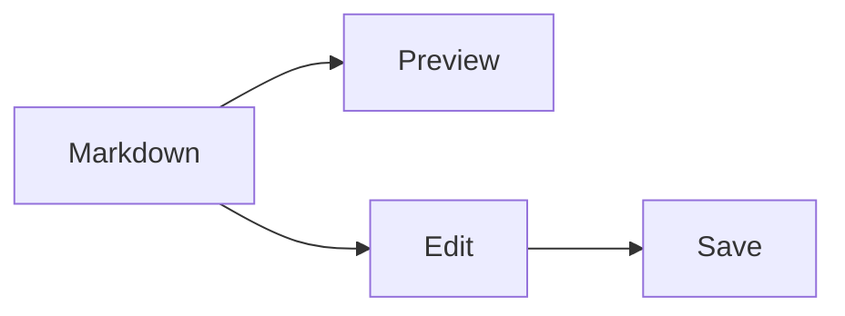

# madmd

Markdown, quietly.

## GitHub-flavored Markdown

| Feature | Status |
| :--- | :---: |
| Tables, links & lists | ✓ |
| Syntax highlighting | ✓ |
| Math & diagrams | ✓ |

- [x] Fast previews
- [x] Local images
- [ ] One more idea

> [!NOTE]
> A small space for a clear thought.

```swift
struct Markdown {
    let preview = "Beautifully simple."
    func open() async throws {
        try await render(preview)
    }
}
```

## Mathematics

The identity $e^{i\pi} + 1 = 0$, and a little more room:

$$
\int_{-\infty}^{\infty} e^{-x^2} dx = \sqrt{\pi}
$$

## Diagrams



<details><summary>A little more</summary>

**Bold**, *italic*, ~~strikethrough~~, <sub>subscript</sub>, and <sup>superscript</sup>.

</details>


A footnote[^1] and an emoji :sparkles:.

[^1]: Everything stays in your Markdown file.
