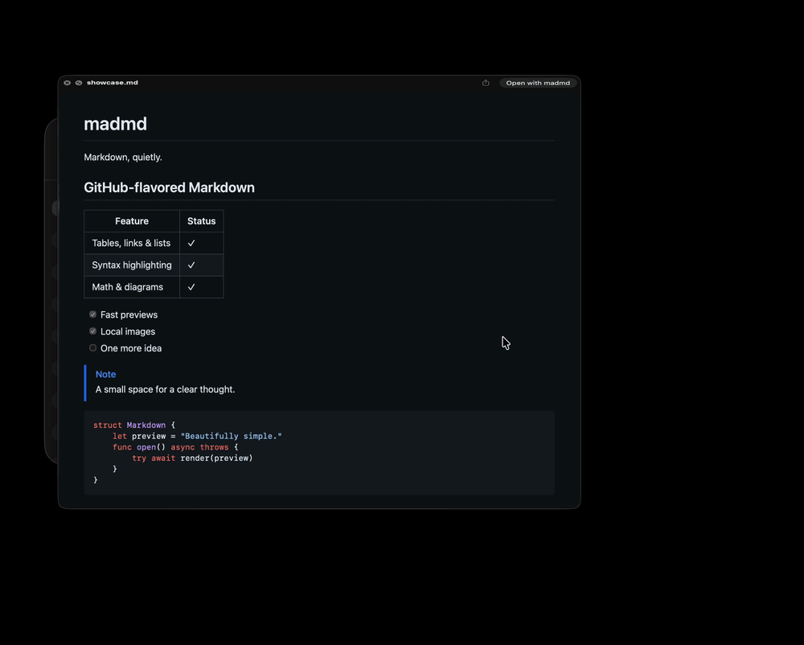

# madmd

A minimal macOS Markdown previewer, editor, and Quick Look extension. macOS 14 or later, Apple silicon and Intel.

The native AppKit window has Preview and Edit tabs, an appearance toggle, and Save. Edit uses Monaco with multiple cursors, find/replace, a command palette, folding, and familiar VS Code editor shortcuts. Files are only written by Save or Save As. Closing a modified file or quitting shows **Cancel** (default), **Save & Quit**, and **Quit Anyway**.

The app and Quick Look share a local renderer with GitHub Markdown styling, tables, task lists, autolinks, strikethrough, footnotes, emoji, alerts, HTML details, images, syntax highlighting, KaTeX math, Mermaid, GeoJSON, TopoJSON, and ASCII STL. GitHub account and repository service features are intentionally excluded. All rendering dependencies ship inside the app; remote images and OpenStreetMap background tiles require a connection. Local GeoJSON overlays render without map tiles.

## Demo

Select a Markdown file in Finder and press **Space** for a Quick Look preview.



## Build and run

Requires Xcode with the macOS SDK, Node.js 22+, npm, and [XcodeGen](https://github.com/yonaskolb/XcodeGen).

```sh
npm ci
npm run build
open build/Build/Products/Release/madmd.app Fixtures/showcase.md
```

`madmd.xcodeproj` is also checked in. `project.yml` is its source of truth. Run `npm run build:web` before the first Xcode build, or after changing web sources. The release build is a universal app with local ad hoc signing.

## Enable Markdown previews in Finder

After building, install the app and register its Quick Look extension:

```sh
bash Scripts/install.sh
```

This installs to `~/Applications/madmd.app`. An optional first argument selects another app destination.

1. Open the installed **madmd** app once.
2. Open **System Settings → General → Login Items & Extensions**. Under **Extensions**, click the info button next to **Quick Look**, enable **madmd**, and click **Done**. The location can vary with macOS version; search System Settings for **Quick Look** if needed. See Apple's [extension settings guide](https://support.apple.com/en-gb/guide/mac-help/-mtusr003/mac).
3. If another app handles Markdown previews, disable its Markdown Quick Look extension in the same list. The installer does not disable other apps' extensions.
4. Select a `.md` file in Finder and press **Space**. Press **Space** again to close the preview.

Quick Look works independently of the default app used to open Markdown files.

Updates stage and verify the full bundle before replacing it, refresh the extension registration, and reset Quick Look's generator cache. Close an existing Quick Look panel before updating so Finder does not retain the old panel's cached result. The installer restores the previous app if replacement or registration fails.

The source build is suitable for local use. Distribution to other Macs needs your Developer ID, hardened runtime signing of both targets, and notarization. No signing credentials or provisioning profiles are included.

## Set madmd as the default Markdown app

1. In Finder, select a Markdown file and press **⌘I** (**File → Get Info**).
2. Expand **Open with** and choose **madmd**. If it is missing, choose **Other…** and select `~/Applications/madmd.app` (or your custom installation destination).
3. Click **Change All…**, then confirm with **Continue**.
4. Double-click a Markdown file to open it in madmd.

Repeat for other Markdown extensions you use if they still open in another app: `.markdown`, `.mdown`, `.mkdn`, `.mkd`, and `.mdwn`. See Apple's [default app instructions](https://support.apple.com/en-gb/guide/mac-help/mh35597/mac).

## Verify

```sh
npm test
bash Scripts/test-native.sh
```

The JavaScript tests cover syntax, sanitization, math layout, diagram source preservation, and a large document. The native suite opens real WebKit views and verifies the editor worker, both appearances, relative images, native dirty state, absence of autosaving, explicit atomic saves, undo, all four diagram formats, and Quick Look completion. It writes `build/native-tests.json`. Tests use temporary files. Finder preview selection should also be checked on the target Mac because the OS manages extension precedence.

## Implementation

- **App/** — native document windows, menus, manual saves, external-change protection, and file watching. UTF-8 and UTF-16 files preserve encoding and BOM; Monaco preserves the detected line-ending convention.
- **Shared/** — renderer bridge and a private resource scheme. Assets are local. Image and link paths are confined to the document folder, or the enclosing Git repository when available. Hidden files and symlink escapes are blocked. Quick Look has a read-only filesystem sandbox exception so referenced local images can load without a separate folder prompt. The scheme handler still enforces the document/repository boundary. macOS privacy controls remain in force. The app itself is not sandboxed.
- **QuickLook/** — sandboxed view-based preview extension. File reads happen off the main thread, and completion waits for the file's rendered content. Cancellation and reused-controller requests are isolated.
- **Web/** — sanitized GitHub-style renderer and lazy editor/diagram bundles. Quick Look's resource bundle excludes Monaco entirely. Mermaid uses strict security, untrusted scripts and active embeds are removed, and local file access is mediated by native code.

The application has no telemetry, CDN dependencies, or background server. Third-party license notices are packaged with the renderer.

## License

[MIT](LICENSE) © 2026 Artur Rosa. Third-party dependencies retain their respective licenses; notices are included in the app's renderer bundle.
